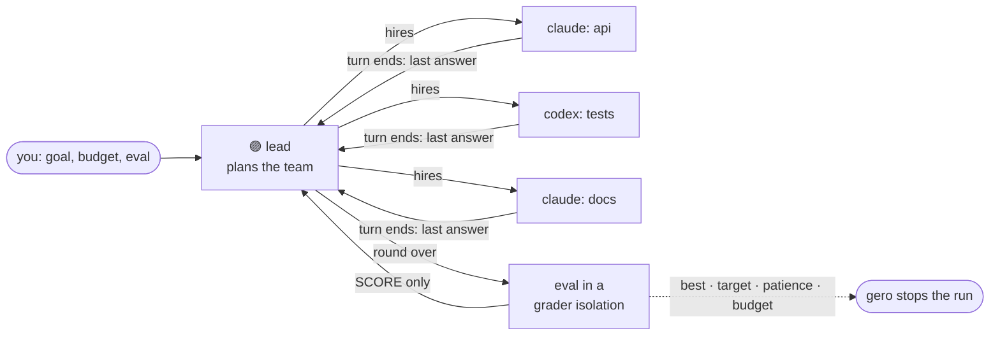

<p align="center">
  
</p>

<p align="center">
  <a href="#get-going-in-a-minute"><b>Quick start</b></a> ·
  <a href="#teams-that-run-themselves">Teams</a> ·
  <a href="#agents-that-talk-schedule-and-delegate">Mail · Cron · Control</a> ·
  <a href="#safe-enough-to-leave-running">Safety</a> ·
  <a href="#questions-youre-probably-asking">FAQ</a> ·
  <a href="docs/REFERENCE.md">Reference</a>
</p>

<p align="center">
  
  
  
  
</p>

---

**gero is an orchestrator for Claude Code and Codex.** Run as many agents as
your work needs, side by side, from one sidebar. Let them mail each other
and set their own schedules. Hand a goal and a scoring script to a lead
agent, and it hires a team, runs it round after round, and keeps whatever
scores best. You steer from a TUI, a web app or your phone. Every agent runs
in a fenced VM on your Mac, so you can leave them running unattended.

> [!TIP]
> If you've ever had six terminal tabs of `claude` open and caught yourself
> copy-pasting between them, gero is for you.

## You've become the scheduler

One coding agent is a great pair programmer. Five of them make you a
full-time dispatcher.

| Today, without gero | 😩 |
|---|---|
| **One tab per agent.** Which one finished? Which one is waiting on you? | You alt-tab to find out |
| **Agents can't talk to each other.** The refactor agent changes an interface, and the test agent never hears about it | You relay the message by hand |
| **Nothing happens while you're away.** No "check CI every morning", no "keep going until the benchmark passes" | The agents sit idle when you aren't there |
| **Claude or Codex?** Each CLI has its own UI, its own commands, its own login | You pick one and stick with it |
| **Unattended means risky.** Skipping permissions lets the agent do anything you can do | So you approve each step, and you're the bottleneck again |

**gero takes over the dispatching, so you can get back to the work.**

## Get going in a minute

```sh
brew trust hongzio/tap && brew tap hongzio/tap
brew install gero                 # brings Apple's container runtime with it
sudo gero pf install              # once: the network fence helper

gero iso create dev               # a fenced Linux VM for your agents
gero iso login dev claude         # and codex; also from the web, even on a phone
gero agent new --iso dev --kind claude "write a tiny HTTP server in Go, with tests"
gero agent new --iso dev --kind codex  "review what the other agent writes"
gero web                          # one sidebar for both
```

## One sidebar for every agent

Claude Code and Codex agents sit in one list, grouped into teams, each with
a status dot. A grey dot means an idle agent wants a look. Tap it to park
the agent until its next turn.

<table>
<tr>
<td width="33%" valign="top">

### ⌨️ TUI
`gero tui`

Agents on the left, the conversation in the middle, settings behind
`ctrl+o`. `ctrl+a` answers an approval. Every key can be rebound.

</td>
<td width="33%" valign="top">

### 🌐 Web
`gero web`

`/` commands, an `@` file picker and Codex `$skills` as you type. `j`/`k`
moves between agents, and vim keys scroll the conversation.

</td>
<td width="33%" valign="top">

### 📱 Phone
`tailscale serve`

`gero web` prints the exact command. Approve a deploy from the train.
Answer Claude's question from the couch.

</td>
</tr>
</table>

You run the same agent lifecycle whichever CLI is underneath:

| | What it does |
|---|---|
| `/model` `/effort` `/approvals` | Changed per agent at any time. The change outlasts the process |
| `/stop` | Ends the turn now |
| `/new` | A fresh session that keeps the agent's ID, crons and waiting mail. The old one is archived |
| **Restore** | Goes back to an archived session, picking up where it left off |
| **Fork** | A new agent that starts from a copy of this one's conversation |
| **Send when idle** | On the web, queue your next message. It goes when the current turn ends |

## Teams that run themselves

This is the main event. **Give a lead a goal, a budget and a scoring
script, then walk away.**

```sh
gero iso expose dev team
gero team lead lab tara --budget 5M \
     --eval-iso grader --eval 'sh /home/agent/grader/run.sh' --patience 3
gero agent send tara '/gero-team Build what SPEC.md describes.'
```



The lead **designs the team, not the code.** It picks the roles the work
needs, starts Claude and Codex agents for them, and hears from each one as
its turn ends. Once the round is over, gero scores it, and the lead uses
the score to design the next team. The way of working follows EAT (Evolving
Agent Teams, [arXiv 2610.36848](https://arxiv.org/abs/2610.36848)).

gero keeps the run within your terms:

- 🎯 **Scored where the agents can't reach.** Each round, gero copies the
  work into a separate grader isolation and runs your eval there, as a user
  that can't change the grader. The lead hears only the score.
- 💸 **Within a budget.** The run stops when the token budget is spent. On a
  subscription, `--plan-ceiling` stops the lead from starting agents once a
  plan window is nearly used up.
- 🛑 **It knows when to quit.** The run stops at `--target`, or after
  `--patience` evals in a row with no new best score.
- 🚦 **It stays within limits.** At most `--max-live` of the lead's agents
  run at once, and a turn that runs past `--turn-minutes` is stopped and
  asked for a report.
- 👀 **You can watch it.** `gero team show lab`, the team's dialog on the
  web or its page in the TUI show the spend, every score and the lead's
  agents. **Run eval now**, **Resume** and **Reset best** are one click away.

## Agents that talk, schedule and delegate

Turn on each service per isolation. Each one installs a skill, so the agents
know how to use it.

<table>
<tr>
<td width="50%" valign="top">

### ✉️ Mail
```sh
gero iso expose dev mail
```
Every agent has an inbox. A message from a peer waits until the agent is
idle, then arrives as a turn of its own, marked as coming from another
agent and not from you. Isolations exchange mail only where you open a way
(`--to`). Rate limits wind down two agents that would otherwise keep
replying to each other.

</td>
<td width="50%" valign="top">

### ◷ Cron
```sh
gero agent cron ci-bot --add "*/30 9-18 * * 1-5" \
  "check CI; fix what is red"
```
Schedule your own messages, or let agents schedule their own with
`gero iso expose dev cron`. Supports `@every 2h`, `--once`, and `--wait` to
hold a run until the agent is idle. Runs missed while the Mac slept come
due once, not all at once.

</td>
</tr>
<tr>
<td colspan="2" valign="top">

### 🎛️ Control: hand an agent part of the gero command
```sh
gero env add control ops --allow agent.ls,agent.log,agent.new,agent.send --max-live 3
gero iso expose dev control ops
```
Tick the actions an agent may take: list, create, message, fork or archive
agents, set crons, run evals. Anything an agent makes or sends is marked as
coming from it. Credentials, approvals, making or removing isolations, and
the fence are never on the list.

</td>
</tr>
</table>

## Never lose a run

- **The daemon can crash.** The agents keep running under `gero-shim` inside
  the VM, which keeps a durable, sequenced log of everything they read and
  write. The daemon replays the log and catches up.
- **The Mac can reboot.** The turn that was running shows `interrupted`, and
  your next message resumes the same session.
- **gero can upgrade.** After `brew upgrade gero`, the next gero command
  moves the daemon onto the new version, and the agents carry on.

## Safe enough to leave running

Orchestration only pays off if you can walk away. So every agent runs with
no one approving each step, inside a box that holds even if it misbehaves:

| | |
|---|---|
| 📦 **A VM per isolation** | Apple's `container` gives each isolation its own lightweight Linux VM. It doesn't see your files unless you share a folder, read-only by default |
| 🧱 **A measured fence** | pf walls each isolation off the Mac and the LAN over IPv4 and IPv6. **The daemon tests the fence from inside** against every address your Mac has, and agents take no turns until the test passes |
| 🔑 **Credentials it can use but never read** | git, AWS, Postgres, Slack, Notion, Linear and more go through proxies on the Mac. Each proxy adds your credential and checks the request against an allowlist, so the agent never sees the token |
| 🙋 **Approvals if you want them** | `never` · `auto` (a reviewer model checks each action) · `ask` · `default`, set per agent at any time |

```sh
gero env add git work --allow-repo acme/api     # only this repo
gero iso expose dev git work                    # dev's agents push with your token, never holding it
gero iso verify dev                             # check every guarantee, from inside, now
```

[How the fence and the proxies work →](docs/REFERENCE.md#network-fence)

## A day with gero

> **08:55.** A cron you set last week wakes `ci-bot`: *"check CI; fix what
> is red."* By 09:10 there's a green build and a PR.
>
> **11:30.** On the train, your phone shows Claude waiting on a question with
> three options. You tap one.
>
> **14:00.** A Codex agent takes the refactor and a Claude agent takes the
> tests. They mail each other about the interface. You don't relay a word.
>
> **18:00.** You hand `tara` a spec, a 5M-token budget and a grader. You close
> the laptop.
>
> **08:00 the next day.** `gero team show lab` lists six rounds, the best
> score after round 4, and how many tokens it spent. Nothing on your Mac was
> touched.

## How it compares

| | Tabs of CLIs | In-CLI subagents | Cloud agents | **gero** |
|---|:-:|:-:|:-:|:-:|
| Many agents, one place to watch and steer | ❌ | ⚠️ *(within one session)* | ✅ | ✅ |
| Claude Code **and** Codex together | ❌ | ❌ | ❌ | ✅ |
| Agents message each other | ❌ | ❌ | ❌ | ✅ |
| Agents on a schedule | ❌ | ❌ | ⚠️ | ✅ |
| A lead that runs rounds toward a score, within a budget | ❌ | ❌ | ❌ | ✅ |
| Runs unattended without risking your machine | ❌ | ❌ | ✅ | ✅ |
| Your machine, your files, your subscription | ✅ | ✅ | ❌ | ✅ |
| Steer from your phone | ❌ | ❌ | ✅ | ✅ |

## Questions you're probably asking

<details>
<summary><b>Do I have to use teams?</b></summary>

No. Most people start with a few agents side by side, plus a cron or two.
Teams are for when you can say what "better" means in a script that prints
`SCORE: <number>`. `gero team help` walks you through a first team.
</details>

<details>
<summary><b>How does a lead not burn through my subscription?</b></summary>

Set `--budget` (in tokens, not counting prompt-cache reads) and
`--plan-ceiling`, which defaults to 90% of a plan window. gero refuses to
run a lead without a budget on a pay-per-use API key.
</details>

<details>
<summary><b>Can I use my Claude subscription?</b></summary>

Yes. Run `claude setup-token` once (the token is valid for a year) and
`gero account add`. Any number of isolations can share it. Codex logs in
once per isolation, because a ChatGPT login can't be shared. You can finish
that login from any browser, including your phone's.
</details>

<details>
<summary><b>What stops two agents from mailing each other forever?</b></summary>

The skill tells them not to answer what needs no answer. An isolation sends
at most 20 mails a minute, and an inbox holds 50.
`gero agent inbox <id> --clear` ends a loop on the spot.
</details>

<details>
<summary><b>Can I see a dev server an agent runs?</b></summary>

`gero env add port web --port 5173` gives you `http://web.localhost:5173` on
your Mac, on the Mac's loopback only. Connections only ever start on the
Mac.
</details>

<details>
<summary><b>Can I give agents my own skills?</b></summary>

`gero env add skill pdf --path ~/skills/pdf` checks the skill the way both
CLIs read it, refuses a broken one rather than dropping it silently, and
installs it for Claude Code and Codex alike.
</details>

## The fine print

- **Apple silicon Macs only.** gero is built on Apple's `container`.
- **The CLI's own login lives in the VM.** Service credentials stay on the
  Mac, but Claude's account token or Codex's login is in the isolation,
  where the CLI needs it.
- **Agents in one isolation share a user.** Isolations are the trust
  boundary. A team's agents work in the lead's isolation.
- **A writable shared folder is a real hole.** Shares are read-only by
  default, and gero refuses `~/.ssh`, `~/.aws`, `~/Library` and the like.
- **The CLI versions are pinned.** gero parses what Claude Code and Codex
  print, so a new CLI version is checked before an image ships with it
  ([how](docs/REFERENCE.md#claude-code-and-codex-in-the-image)).

## Learn more

- 📖 **[The reference](docs/REFERENCE.md)**: every command, flag and guarantee, in depth
- 🤝 [Teams](docs/REFERENCE.md#teams) · [Mail](docs/REFERENCE.md#mail) · [Cron](docs/REFERENCE.md#cron) · [Control](docs/REFERENCE.md#control)
- 🔒 [Network fence](docs/REFERENCE.md#network-fence) · [Credential proxies](docs/REFERENCE.md#credential-proxies) · [Verify](docs/REFERENCE.md#verify)
- 🛠️ [Build from source](docs/REFERENCE.md#build): `mise install && mise run build`

<p align="center"><sub>Stop dispatching agents. Start leading a team.</sub></p>
